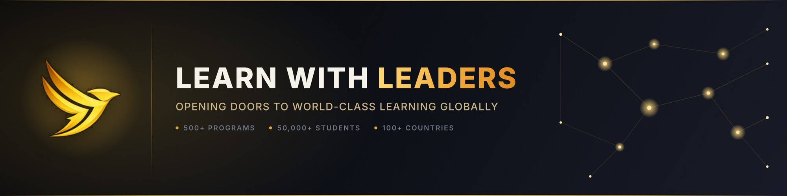

  

  <a href="https://www.learnwithleaders.com">Website</a> ·
  <a href="https://www.linkedin.com/company/learn-with-leaders/">LinkedIn</a> ·
  <a href="https://twitter.com/LearnLeaders">Twitter/X</a> ·
  <a href="https://www.instagram.com/learnwithleaders/">Instagram</a> ·
  <a href="mailto:team@learnwithleaders.com">team@learnwithleaders.com</a>

---

### Who we are

Learn with Leaders is a global education initiative connecting middle and high school students with mentors, faculty, and peer networks from leading universities — including Harvard, Yale, Cambridge, MIT, NYU, and the University of Geneva — through camps, conferences, fellowships, certificate programs, and competitions.

We partner with student-run clubs and organizations worldwide to bring experiential, project-based learning to students beyond the traditional classroom: entrepreneurship, design thinking, leadership, sustainability, Model UN, and finance.

- 500+ programs delivered
- 50,000+ participants
- 3,000+ partner schools
- 100+ countries reached

### Our mission

To effect a paradigm shift in education by introducing a need-of-the-hour curriculum that helps teenagers explore their interests, build real-world skills, and rise as future leaders.

### What's in this organization

This is the engineering home of Learn with Leaders — the software, data, and automation behind our website, internal tools, and integrations. Repositories here are a mix of public (demos, docs) and private (production systems).

### Team

Co-founded by **Gunjan Aggarwal**, **Bejoy Suri**, and **Shubham Gupta**.

### Get in touch

Website: https://www.learnwithleaders.com · Email: team@learnwithleaders.com
